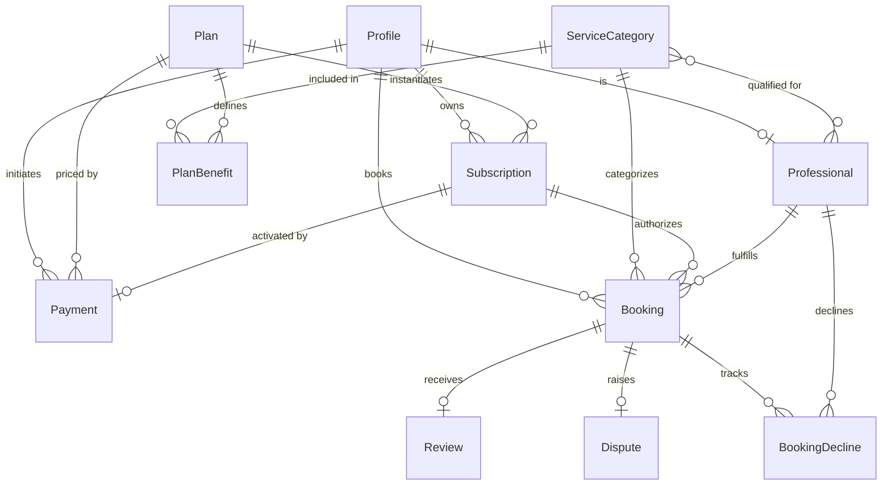
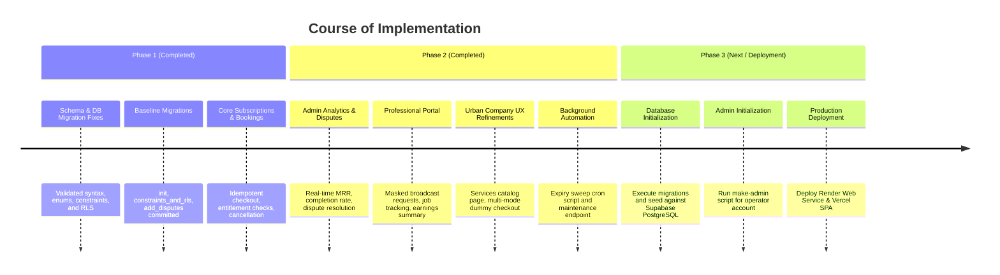

# Technical Documentation: Subscription-Based Home Care Platform

**Project Title:** Subscription-Based Home Care Platform  
**Collaborating Organization:** Unified Mentor ([unifiedmentor.com](https://www.unifiedmentor.com/))  
**Industry Benchmark / Reference Model:** Urban Company ([urbancompany.com](https://www.urbancompany.com/))  
**Document Version:** 1.0.0  
**Stack Architecture:** React (Vite) + Node.js (Express) + Supabase (PostgreSQL / Prisma ORM)  
**Hosting Topology:** Vercel (Frontend SPA) + Render (Backend REST API Web Service)  

---

## 1. Executive Summary & Problem Analysis

### 1.1 Context
In most urban households, home care and maintenance services (cleaning, plumbing, electrical inspections, air conditioner servicing, appliance checkups) are conducted reactively on an ad-hoc, on-demand basis. When a household only calls a technician after a catastrophic breakdown occurs, it experiences:
- **Unpredictable and exorbitant one-time repair bills.**
- **Difficulties identifying trustworthy, vetted technicians during urgent distress.**
- **Lengthy wait times during peak emergency seasons.**
- **Inconsistent service standards, lack of warranty, and zero pricing transparency.**
- **Accelerated degradation of physical home infrastructure** due to the absence of routine preventive checkups.

### 1.2 Product Vision
The Subscription-Based Home Care Platform transforms reactive emergency maintenance into a structured, proactive, and predictable subscription ecosystem. By offering tiered monthly, quarterly, and annual maintenance plans with scheduled inspections, guaranteed technician availability, and priority emergency response, the platform benefits both households and local professionals:
- **Households** enjoy predictable expenses, automated routine inspections, and dependable workmanship.
- **Service Professionals** obtain consistent, recurring income streams, verified digital profiles, and optimized dispatch schedules.
- **Platform Operators** achieve predictable Monthly Recurring Revenue (MRR), strong user retention, and high customer lifetime value (LTV).

---

## 2. Core Objectives & Key Performance Indicators (KPIs)

### 2.1 Primary & Secondary Objectives
| Type | Objective | Technical / Operational Mechanism |
| :--- | :--- | :--- |
| **Primary** | Affordable subscription maintenance | Tiered plans (Basic, Standard, Premium) with defined allowances. |
| **Primary** | Regular preventive servicing | Anchored benefit windows ensuring timely service consumption. |
| **Primary** | Verified service professionals | Administrative verification and strict role-based access. |
| **Primary** | Predictable customer relationships | Automated renewal reminders, dispute handling, and service history. |
| **Secondary** | Digitize local technicians | Dedicated Professional portal with earnings and broadcast requests. |
| **Secondary** | Transparent, zero-surprise pricing | Server-side pricing snapshots, integer paise calculations, simulated checkout. |
| **Secondary** | Reduce emergency repair incidents | Scheduled inspections detecting wear-and-tear before failure. |

### 2.2 Key Performance Indicators (KPIs) Formulation
1. **Monthly Recurring Revenue (MRR):**
   $$\text{MRR} = \sum_{\text{Active Monthly Subs}} \text{Price} + \sum_{\text{Active Quarterly Subs}} \frac{\text{Price}}{3} + \sum_{\text{Active Yearly Subs}} \frac{\text{Price}}{12}$$
   *Implemented natively in `/api/admin/analytics` in integer paise.*
2. **Customer Retention & Renewal Rate:**
   $$\text{Renewal Rate} = \frac{\text{Renewed or Active Continuing Subscriptions}}{\text{Total Subscriptions Expired in Period}} \times 100\%$$
3. **Service Completion Rate:**
   $$\text{Completion Rate} = \frac{\text{Completed Bookings}}{\text{Total Bookings Requested}} \times 100\%$$
4. **Average Customer Satisfaction Rating:**
   $$\text{Avg Rating} = \frac{1}{N} \sum_{i=1}^{N} \text{Rating}_i \quad (\text{Scale: } 1.00 \text{ to } 5.00)$$

---

## 3. Technology Stack & Architectural Decision Record

```
+-----------------------------------------------------------------+
|                         CLIENT TIER                             |
|  React 18 + Vite (SPA) · React Router DOM v6 · Vanilla CSS      |
|  Hosted on Vercel · Fast First Contentful Paint (<1.2s)         |
+-----------------------------------------------------------------+
                                |
                   HTTPS / JSON REST APIs (JWT Auth)
                                |
+-----------------------------------------------------------------+
|                       APPLICATION TIER                          |
|  Node.js (>=20) + Express 5 · Helmet · Rate-Limiting · Zod      |
|  Jose (JWKS Asymmetric Token Verification) · Prisma Client      |
|  Hosted on Render (Web Service behind reverse proxy)            |
+-----------------------------------------------------------------+
                                |
             PostgreSQL Wire Protocol (Prisma ORM)
                                |
+-----------------------------------------------------------------+
|                         DATA TIER                               |
|  Supabase PostgreSQL (AWS Multi-AZ)                             |
|  - PgBouncer Pooled Connection (Port 6543) for Application      |
|  - Direct Session Connection (Port 5432) for Schema Migrations   |
|  - Row-Level Security (RLS) Deny-by-Default (API Access Block)   |
|  - Check Constraints & Partial Unique Indexes                   |
+-----------------------------------------------------------------+
```

### 3.1 Architectural Constraints
- **Language & Runtime:** Pure JavaScript (ES Modules). No TypeScript transpilation churn; validated at runtime via Zod schemas and checked with `node --check`.
- **CSS Strategy:** Pure, maintainable modular CSS (`styles.css`) without heavyweight CSS-in-JS runtimes, ensuring sub-3-second load times on mobile devices.
- **Data Persistence:** Supabase PostgreSQL accessed strictly through Prisma ORM on the backend. Browser clients never connect directly to Supabase PostgreSQL or PostgREST tables.
- **Simulated Financial Transactions:** 100% test-mode payment gateway supporting simulated UPI, Cards, and Net Banking with cryptographic idempotency keys (`idempotencyKey`).

---

## 4. Database Schema & Data Integrity Design

The relational schema is defined in `backend/prisma/schema.prisma` and deployed via versioned SQL migrations.

### 4.1 Entity Relationship Overview



### 4.2 Data Models Specification
1. **Profile (`Profile`)**: Central identity entity keyed to Supabase Auth UUID (`id`). Holds authoritative `role` (`CUSTOMER`, `PROFESSIONAL`, `ADMIN`) and account suspension flag.
2. **ServiceCategory (`ServiceCategory`)**: Home maintenance verticals (`cleaning`, `plumbing`, `electrical`, `ac-servicing`, `appliance`).
3. **Plan (`Plan`) & PlanBenefit (`PlanBenefit`)**: Subscription catalog. Benefits define `allowance` (integer or `null` for unlimited) and `periodMonths` (e.g. 1 month for cleaning, 3 months for quarterly AC).
4. **Subscription (`Subscription`)**: Snapshot of purchased terms (`planName`, `pricePaise`, `interval`, `benefitsSnapshot`, `startsAt`, `endsAt`). A partial unique index guarantees at most one `ACTIVE` subscription per customer.
5. **Payment (`Payment`)**: Audit trail of simulated transactions (`amountPaise`, `idempotencyKey`, `status: PENDING | SUCCEEDED | FAILED`).
6. **Booking (`Booking`)**: Service appointment (`slotStart`, `address`, `city`, `status: PENDING | ACCEPTED | IN_PROGRESS | COMPLETED | CANCELLED`). A unique index `[professionalId, slotStart]` prevents double-booking.
7. **Dispute (`Dispute`)**: Customer grievance on completed or cancelled jobs (`status: OPEN | RESOLVED | REFUNDED`, `resolutionNote`).
8. **Review (`Review`)**: Ratings (1 to 5) and feedback tied to completed bookings.

### 4.3 Database Safeguards & Constraints
- `plan_price_nonneg`: `CHECK ("pricePaise" >= 0)`
- `benefit_allowance_pos`: `CHECK ("allowance" IS NULL OR "allowance" > 0)`
- `benefit_period_pos`: `CHECK ("periodMonths" BETWEEN 1 AND 12)`
- `review_rating_range`: `CHECK ("rating" BETWEEN 1 AND 5)`
- `one_active_subscription_per_customer`: Partial unique index on `"Subscription"("customerId") WHERE "status" = 'ACTIVE'`
- **RLS Lockdown:** Tables enable Row-Level Security with zero public policies, revoking privileges from `anon` and `authenticated` PostgREST roles.

---

## 5. Security & Authentication Architecture

### 5.1 Token Verification Workflow
1. Client acquires Supabase Auth JWT upon sign-in.
2. Client attaches bearer token to Express requests: `Authorization: Bearer <token>`.
3. Backend middleware (`backend/src/auth.js`) downloads and caches signing public keys using `createRemoteJWKSet` (`jose`) from Supabase's JWKS endpoint (`<SUPABASE_URL>/auth/v1/.well-known/jwks.json`).
4. Verifies signature, expiry, audience (`authenticated`), and issuer.
5. Queries the database `Profile` table directly by `payload.sub`. **Role is never trusted from client payloads or JWT metadata.**

### 5.2 Authorization Matrix
| Resource / Action | Anonymous | Customer | Professional (Pending) | Professional (Approved) | Administrator |
| :--- | :---: | :---: | :---: | :---: | :---: |
| Browse Plans & Categories | Yes | Yes | Yes | Yes | Yes |
| Purchase Subscription | No | Yes | No | No | No |
| Create Booking | No | Yes (Active Sub) | No | No | No |
| Cancel Own Booking | No | Yes | No | No | No |
| Raise Booking Dispute | No | Yes | No | No | No |
| View Broadcast Service Requests | No | No | No | Yes (Same City/Skill) | No |
| Accept / Update Job Status | No | No | No | Yes (Assigned) | No |
| View Personal Earnings | No | No | No | Yes | No |
| Approve/Reject Professionals | No | No | No | No | Yes |
| Manage Plans & Pricing | No | No | No | No | Yes |
| View System Analytics (MRR) | No | No | No | No | Yes |
| Resolve Disputes & Refunds | No | No | No | No | Yes |

---

## 6. Business Logic & State Machines

### 6.1 Booking Lifecycle State Machine
```
[CUSTOMER BOOKS] 
       │
       ▼
    PENDING ──────────────(Customer Cancels)─────────────► CANCELLED
       │                                                      ▲
(Pro Accepts)                                                 │
       │                                                      │
       ▼                                                      │
   ACCEPTED ──────────────(Customer Cancels)──────────────────┤
       │
(Pro Starts Job)
       │
       ▼
  IN_PROGRESS
       │
(Pro Completes Job)
       │
       ▼
   COMPLETED ───► [Eligible for Customer Review & Dispute]
```
- **Concurrency Protection:** Job acceptance executes atomically via `prisma.booking.updateMany({ where: { id, status: 'PENDING', professionalId: null } })`. First professional to accept secures the job.
- **Entitlement Restoration:** If a customer cancels while `PENDING` or `ACCEPTED`, the slot and entitlement are immediately freed.

### 6.2 Anchored Benefit Calculation
Benefit usage is calculated against rolling multi-month windows anchored to the customer's subscription start date:
```javascript
export function benefitWindow(startsAt, periodMonths, targetDate) {
  let k = 0;
  while (k < 120 && addMonths(startsAt, (k + 1) * periodMonths) <= targetDate) k++;
  return [addMonths(startsAt, k * periodMonths), addMonths(startsAt, (k + 1) * periodMonths)];
}
```
*Example:* A customer subscribing on Jan 10 with a quarterly AC servicing benefit has Window 1: Jan 10 – Apr 10, Window 2: Apr 10 – Jul 10. Bookings inside that window consume from that window's quota only.

---

## 7. Simulated Payment System Design

The payment integration supports test-mode payment methods without exposing real financial liabilities:
- **UPI Simulation:** Virtual payment address validation (e.g. `user@dummyupi`).
- **Card Simulation:** Test numbers (e.g. `•••• •••• •••• 4242`).
- **Net Banking Simulation:** Simulated bank dispatch (HDFC, ICICI, SBI).
- **Idempotency Safeguard:** Every purchase attempt transmits an `idempotencyKey: UUID`. Retried calls with identical keys return the original outcome without double-billing or issuing duplicate active subscriptions.
- **Outcome Testing:** In development/test mode, testers can toggle between `APPROVE` and `DECLINE` to verify that failed payments do not activate subscriptions.

---

## 8. REST API Specification

### 8.1 Public Routes (`/api`)
- `GET /api/plans` — Returns active subscription plans and benefits.
- `GET /api/categories` — Returns available service categories.

### 8.2 Customer Routes (`/api`)
- `GET /api/me` — Fetches authenticated profile, role, and professional status.
- `GET /api/subscriptions/current` — Returns active subscription with live benefit consumption.
- `POST /api/subscriptions/purchase` — Idempotent simulated plan purchase.
- `POST /api/subscriptions/cancel` — Cancels active subscription.
- `GET /api/payments` — Lists customer simulated payment history.
- `GET /api/bookings` — Lists customer bookings and fulfillment status.
- `POST /api/bookings` — Books an eligible slot against plan allowances.
- `POST /api/bookings/:id/cancel` — Cancels a pending or accepted booking.
- `POST /api/bookings/:id/review` — Submits rating (1–5) and review for completed job.
- `POST /api/bookings/:id/dispute` — Files a dispute/refund request.

### 8.3 Professional Routes (`/api/pro`)
- `POST /api/pro/apply` — Customer applies to become a service professional.
- `GET /api/pro/me` — Returns status (`PENDING | APPROVED | REJECTED`), city, and trades.
- `GET /api/pro/requests` — Lists broadcast service requests in matching city and category (address masked).
- `POST /api/pro/requests/:id/accept` — Atomically accepts service request.
- `POST /api/pro/requests/:id/decline` — Hides request for this professional.
- `GET /api/pro/jobs` — Lists accepted, in-progress, and completed jobs with customer details.
- `POST /api/pro/jobs/:id/status` — Updates status (`IN_PROGRESS`, `COMPLETED`).
- `GET /api/pro/earnings` — Returns completed job metrics, ratings, and simulated payout totals.

### 8.4 Admin Routes (`/api/admin`)
- `GET /api/admin/plans` & `POST /api/admin/plans` — Catalog management.
- `PATCH /api/admin/plans/:id` — Update pricing or active state.
- `GET /api/admin/professionals` — List applicants filtered by status.
- `PATCH /api/admin/professionals/:id` — Approve or reject professional application.
- `GET /api/admin/analytics` — Live operational KPIs (MRR, retention, completion, ratings).
- `GET /api/admin/disputes` — List open customer disputes.
- `PATCH /api/admin/disputes/:id` — Resolve dispute or simulate refund.
- `POST /api/admin/maintenance/sweep-expired-subscriptions` — Sweeps expired subscriptions.

---

## 9. Phased Implementation Roadmap & Verification Gates



### 9.1 Verification Checklist & Runbook
1. **Linting & Code Integrity:**
   ```bash
   cd backend && npm run lint
   ```
2. **Business Rules & Authorization Tests:**
   ```bash
   cd backend && npm test
   ```
   *Verifies role gate enforcement, state machine transitions, slot validation, and anchored date calculations.*
3. **Frontend Production Build:**
   ```bash
   cd frontend && npm run build
   ```
   *Verifies Vite module transformation, asset chunking, and bundle size.*
4. **Database Migration & Seeding:**
   - **Method A (Supabase Dashboard SQL Editor):** Copy and run [`supabase_schema.sql`](file:///c:/Users/HP/Downloads/homecare/supabase_schema.sql).
   - **Method B (Prisma CLI):**
     ```bash
     cd backend
     npx prisma migrate deploy
     npm run seed
     npm run make-admin -- operator@example.com
     ```
5. **Background Maintenance Execution:**
   ```bash
   cd backend && npm run sweep-expired
   ```
